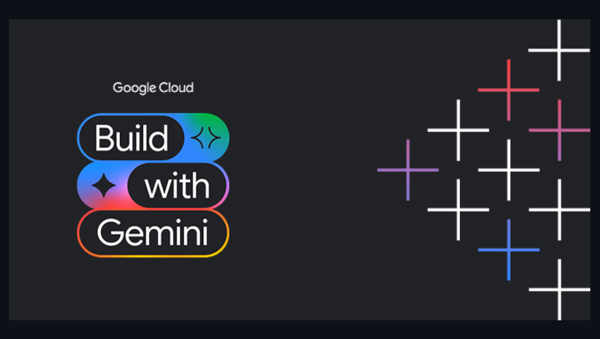

<div align="center">
  
</div>

# Autonomous Notion AI Agent on Google Cloud Platform (GCP)

> An enterprise-grade, serverless AI agent built on GCP that translates natural-language user requests into complex Notion actions, analyzes attached documents with verifiable citations, enforces human-in-the-loop safety approvals, and automatically sends multi-channel completion notifications.

---

## 🌟 Key Features

1. **Natural-Language Agentic Execution**: Accepts freeform commands (e.g., *"Read the attached Q3 roadmap PDF, summarize key milestones, create a quarterly planning page in Notion with a status database, and notify the team on Slack"*).
2. **Comprehensive Notion Tooling**:
   - Search across workspaces (query, filters).
   - Read & create pages with clean Markdown-to-Notion block conversions.
   - Append blocks (tables, code snippets, lists, quotes, callouts).
   - Create databases with custom typed schemas (title, select, date, status, number).
   - Query & insert database rows.
   - Archive pages with mandatory human confirmation gates.
   - Token-bucket rate limiting (~3 rps) and exponential backoff retry on HTTP 429/5xx.
3. **Multi-Format Document Parsing & Grounding**:
   - Extracts page-by-page text from PDF (`pypdf`), DOCX (`python-docx`), TXT, and CSV.
   - Injects verifiable citation stamps (`[Source: document.pdf, Page 3]`) into Notion pages.
4. **Multi-Channel Completion Notifications**:
   - **In-Notion Comment**: Automatically writes a completion comment directly onto the target page with hyperlinks.
   - **Slack**: Sends rich Slack blocks with task duration, step breakdowns, and page links.
   - **Email**: Dispatches HTML email summaries via SendGrid.
5. **Production Human-in-the-Loop Safety**:
   - Destructive actions (such as `notion_archive_page`) automatically pause execution.
   - Issues a confirmation token and awaits explicit human approval via UI or API before proceeding.
6. **Zero-Idle-Cost Serverless Architecture**:
   - Cloud Run services configured with `min_instances = 0` (scales down to \$0/month when idle).
   - Cloud Tasks asynchronous task queue for non-blocking HTTP handoffs.
   - Firestore for task state and execution audit trails.
   - Google Cloud Storage (GCS) with a 7-day automatic lifecycle cleanup for uploaded files.

---

## 🏗 Architecture Overview

```
User (Web UI / REST API / Notion Webhook)
                 │
                 ▼
     [ Cloud Run: notion-agent-api ]
          (min-instances = 0)
          │                 │
    Accepts Task     Uploads Attachments
          │                 │
          ▼                 ▼
   [ Cloud Tasks ]   [ Google Cloud Storage ]
          │          (7-day lifecycle purge)
          │
          ▼ (HTTP POST /tasks/worker/execute)
    [ Cloud Run: notion-agent-worker ]
          (min-instances = 0)
          │
          ├──► [ Vertex AI: Gemini 1.5 Pro / Flash ] (Planner & Verifier)
          ├──► [ Firestore Native ] (Persistent State & Audit Logs)
          ├──► [ Notion API Client ] (Blocks, Pages, Databases)
          └──► [ Multi-Channel Notifications ]
                  ├── In-Notion Page Comments
                  ├── Slack Webhook / Bot
                  └── SendGrid Email
```

---

## 📋 Required Details to Deploy to GCP

When you are ready to deploy this agent to Google Cloud Platform, you will only need to supply:

1. **GCP Project ID**: Your Google Cloud project identifier (e.g., `my-notion-agent-prod`).
2. **GCP Region**: Preferred deployment region (e.g., `us-central1`).
3. **Notion Integration Token**: An Internal Integration Secret (`secret_...`) created in [Notion Developers](https://www.notion.so/my-integrations).
   > **Important:** In your Notion workspace, click the `...` menu on any parent page or database you want the agent to manipulate and select **Connect to -> [Your Integration Name]**.
4. *(Optional)* **Slack Bot Token** (`xoxb-...`) if you wish to receive Slack notifications.
5. *(Optional)* **SendGrid API Key** (`SG....`) if you wish to receive email notifications.

---

## 🛑 How to Stop or Delete Unused Services (Zero-Cost Guarantee)

As requested, we have implemented strict zero-idle-cost controls and simple one-command cleanup tools:

### 1. Automatic Zero-Idle Cost
Both Cloud Run services (`notion-agent-api` and `notion-agent-worker`) are provisioned with `min_instances = 0`.
When there are no incoming requests or active tasks, **all compute containers scale down to 0**, consuming **\$0/hour**.

### 2. Temporary Stop / Pause (Preserves Data)
To stop the services temporarily without deleting your database or task history:
- **Linux / Mac**:
  ```bash
  ./scripts/cleanup_gcp.sh
  # Select option [1] STOP SERVICES
  ```
- **Windows (PowerShell)**:
  ```powershell
  .\scripts\cleanup_gcp.ps1
  # Select option [1] STOP SERVICES
  ```
This removes the Cloud Run endpoints and pauses the Cloud Tasks queue.

### 3. Full Teardown & Deletion (100% Cleanup)
To permanently destroy all created GCP resources:
- **Linux / Mac**:
  ```bash
  ./scripts/cleanup_gcp.sh
  # Select option [2] FULL TEARDOWN
  ```
- **Windows (PowerShell)**:
  ```powershell
  .\scripts\cleanup_gcp.ps1
  # Select option [2] FULL TEARDOWN
  ```
Alternatively, if using Terraform:
```bash
cd infra/terraform
terraform destroy -var-file="terraform.tfvars"
```

---

## 💻 Quickstart: Running Locally

The codebase features an automated **dual-mode mock fallback**: if GCP environment variables are not detected, it uses in-memory Firestore, local disk storage (`.storage/`), and in-process task execution.

### Prerequisites
- Python 3.12+
- `uv` or `pip`

### Step 1: Install Dependencies
```bash
uv venv
uv pip install -r requirements.txt
uv pip install -r requirements-dev.txt
```

### Step 2: Configure Environment
Copy `.env.example` to `.env` and insert your Notion token:
```bash
cp .env.example .env
```

### Step 3: Run the Web UI & API
```bash
uvicorn app.api.main:app --reload --port 8080
```
Open your browser to:
```
http://localhost:8080/
```
You can now submit tasks, inspect live step progress, upload documents, and approve safety confirmation requests.

---

## 🧪 Testing & Validation

The project contains a comprehensive test suite (25 tests) covering converters, rate limiters, document citation extraction, safety gates, API endpoints, and end-to-end multi-step flows.

```bash
# Run pytest
pytest -v

# Run code style linter
ruff check .

# Run static type checker
mypy app
```

---

## 🚀 Cloud Deployment Options

### Option A: Automated Script Deploy (Cloud Build + gcloud)
```bash
export GCP_PROJECT_ID="your-project-id"
export GCP_REGION="us-central1"

# On Linux/macOS:
chmod +x scripts/*.sh
./scripts/setup_gcp.sh

# On Windows:
.\scripts\setup_gcp.ps1
```

### Option B: Terraform Infrastructure as Code
```bash
cd infra/terraform
cp terraform.tfvars.example terraform.tfvars
# Fill in your project_id and notion_token in terraform.tfvars

terraform init
terraform plan
terraform apply
```

---

## 💰 Estimated Monthly GCP Costs (~100 Active Users)

| Service | Usage Profile | Monthly Cost |
| :--- | :--- | :--- |
| **Cloud Run (API & Worker)** | ~100 tasks/day, 1-3 vCPU-seconds per task | **\$0.00** (Well within GCP's 180k vCPU-sec free tier) |
| **Cloud Tasks** | ~3,000 tasks/month | **\$0.00** (Free tier allows 1,000,000 tasks/mo) |
| **Firestore** | ~15,000 document reads/writes/month | **\$0.00** (Free tier allows 50,000 operations/day) |
| **Cloud Storage** | ~5 GB temporary storage with 7-day auto-purge | **<\$0.15** / month |
| **Secret Manager** | 4 active secrets | **<\$0.24** / month |
| **Vertex AI (Gemini 1.5 Pro)** | ~300 requests/day (~150k input tokens/day) | **~\$5.00 - \$12.00** / month |
| **TOTAL ESTIMATED** | Production Serverless | **~\$5.00 - \$12.50 / month** |

---

## 🛡 Security & Compliance
- **Zero Hardcoded Secrets**: All credentials stored in Google Secret Manager or passed via environment variables.
- **Least-Privilege IAM**: Runtime service account only possesses minimal required roles (`roles/datastore.user`, `roles/storage.objectAdmin`, `roles/cloudtasks.enqueuer`, `roles/secretmanager.secretAccessor`, `roles/aiplatform.user`).
- **Webhook HMAC Verification**: Incoming Notion webhooks verified with SHA-256 HMAC signatures.
- **Idempotency**: Duplicate requests with identical `idempotency_key` are rejected or returned the cached task status.
